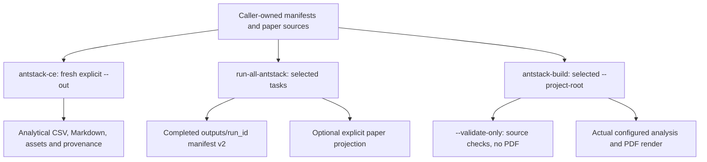

# Workflow Map: Analysis, Canonical Generations and Configured Manuscripts

This navigation guide connects the three supported workflows; it does not define a second build system. Implementation lives in the installed package.



## Choose the Product Before Running a Command

| Product | Owning contract |
|---|---|
| Standalone model result family in a fresh destination | [Getting started](docs/getting_started.md), [API contracts](docs/public_api_contracts.md) |
| Canonical generation and current-invocation paper projection | [Reproducibility](docs/reproducibility.md) |
| Full configured manuscript PDF from caller-owned ordered sources | [PDF rendering guide](PDF_RENDERING_GUIDE.md) |
| Test/build/install/render acceptance and source-bound receipts | [Validation](docs/validation.md) |
| Empirical interpretation and proposed study design | [Scientific validation](docs/scientific_validation.md) |

Standalone CE generation does not implicitly update a paper. The default run-all example does enable explicit paper projection and preserves the prior tree; select a caller-owned config with projection disabled when that publication is not intended. A canonical generated-results PDF is not the full manuscript, and copied `historical_paper` files are not new renders.

## Use Native Commands with Explicit Ownership

```bash
uv run antstack-ce papers/complexity_energetics/manifest.example.yaml --validate-only
uv run antstack-ce papers/complexity_energetics/manifest.example.yaml --out outputs/ce-workflow-run
uv run run-all-antstack --config configs/run_all_antstack.example.yaml --validate-only
uv run antstack-build --project-root . --validate-only
```

The generation destination must be fresh. Validation is not generation or render proof. All-paper build validation regenerates the ignored local `build_report.md`; run-all validation creates no run layout. Full commands, provisioning and safe staging procedures belong in their owning guides above.

Bun scripts are convenience entrypoints from `package.json`, not another scientific implementation. `bun run ce` intentionally needs appended `--out FRESH_ROOT`; it has no reusable overwrite destination.
