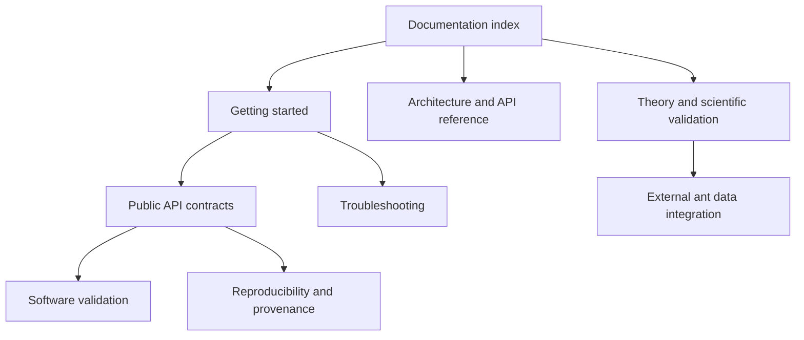

# Ant Stack Documentation: Setup, Models, Outputs, and Publishing

These guides describe the Ant Stack 3.0.0 package and its research repository. A version in source metadata is not evidence of a published release or a successful current render. Use the [root overview](../README.md) for project status.

## Choose a Guide by Task

| Task | Guide |
| --- | --- |
| Install dependencies and run an explicit first workflow | [Getting started](getting_started.md) |
| Understand package layers, project inputs, and artifact ownership | [Architecture](architecture.md) |
| Find Python modules and distinguish model families | [API reference](api_reference.md) |
| Look up authoritative exports, CLI options, and input contracts | [Public API contracts](public_api_contracts.md) |
| Select software acceptance checks and understand their scope | [Validation](validation.md) |
| Preserve input snapshots, source state, and output identities | [Reproducibility](reproducibility.md) |
| Design source- and runtime-bound performance measurements | [Benchmarking](benchmarking.md) |
| Develop without overstating numerical or artifact evidence | [Best practices](best_practices.md) |
| Diagnose dependency, browser, rendering, and ownership failures | [Troubleshooting](troubleshooting.md) |
| Review scientific assumptions and evidence requirements | [Theory](theory.md), [scientific validation](scientific_validation.md) |
| Introduce external ant observations with provenance | [External ant data integration](external_ant_data_integration.md) |

## Keep the Three Workflow Contracts Separate

- **`antstack-ce`** validates a caller-supplied manifest or generates one analytical/synthetic workload result into an explicitly chosen fresh artifact root.
- **`run-all-antstack`** stages and publishes a canonical `outputs/<run_id>/` generation, with optional paper projections and configured historical PDF copies. Its artifact validation is not scientific validation.
- **`antstack-build`** validates or renders configured papers in a caller-owned project selected with `--project-root`. An installed package does not supply that project's manuscripts, configs, bibliography, assets, scripts, or tests.

Validation-only, actual document rendering, the canonical generated-results PDF, and retained historical manuscript PDFs are different operations. See [getting started](getting_started.md) before choosing one; use [validation](validation.md), [reproducibility](reproducibility.md), and [public API contracts](public_api_contracts.md) as the shared authorities rather than copying gate recipes into each guide.

## Interpret Scientific and Publication Status Conservatively

Current workload producers calculate analytical or synthetic results. Repeated deterministic outputs do not establish empirical precision; fitted curves do not establish biological laws. Base canonical and enhanced legacy models are separate families, not interchangeable implementations. No implemented MuJoCo/FlyBody robot, whole active-inference agent, or closed colony loop is implied by the conceptual framework.

Folder documentation describes responsibilities; its presence does not prove that a check passed. A stored PDF, diagram, benchmark sample, or prepared CI workflow does not prove a current successful producer invocation. Native Mermaid rendering remains subject to real browser/sandbox availability; do not disable browser security to turn a failed render into a claimed success.
