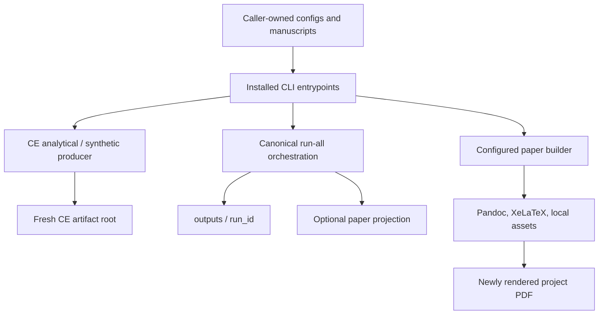

# Architecture: Package Layers, Caller Projects, and Owned Generations

Ant Stack separates reusable scientific and publication code from caller-owned inputs and generated artifacts. It is a research analysis/publishing package, not an implemented robot operating system or colony simulator.

## Package-Owned Implementation and Repository-Owned Inputs

| Layer | Responsibility and boundary |
| --- | --- |
| `antstack_core.analysis` | Energy accounting, workload models, statistics, manifests, optional meters, and reporting helpers. Analytical estimates and hardware observations remain distinct. |
| `antstack_core.cohereants` | Physical conversions, spectroscopy, CHC, and behavioral-analysis helpers; they do not supply empirical data automatically. |
| `antstack_core.figures` | Plotting, local Mermaid rendering, reference checks, and asset helpers. |
| `antstack_core.mathematics` | Context-aware mathematical normalization and label handling for publication text. |
| `antstack_core.orchestration` | Manifest-driven CE generation and canonical run-all staging, inventories, and publication. |
| `antstack_core.publishing` | Document-scoped PDF rendering, templates, reference validation, and provenance. |
| `antstack_core.cli` | Installed entrypoints delegating to package-owned implementations. |
| Caller project / source checkout | Manifests, run configs, ordered paper sources, bibliographies, assets, and paper configs. Repository tests and helper scripts are development inputs, not implicit installed-package resources. |



`antstack-build --project-root CALLER_PROJECT` discovers `papers/<name>/paper_config.yaml` in that project. Without `--project-root`, it uses the current directory, not the installed package's source repository. Sources are taken in configured `content.files` order. Validation-only inspects existing sources; an actual build can first run the configured CE analysis and then render. This is not a unified source-tree script runner.

## Base Canonical and Enhanced Legacy Models Remain Separate

The canonical CE runner selects the base `body`, `brain`, and `mind` workload functions in `loop` or `closed_form` mode. Closed-form mode evaluates accounting formulas; loop mode executes synthetic Python loops and accumulates model counters. Neither is a biomechanical simulation, neural circuit validation, or implemented active-inference control loop.

The enhanced workload functions and `EnhancedEnergyEstimator` use a separate analytical model family. Preserve the selected family, formula revision, parameters, coefficients, and interval in comparisons. Shared names and return dataclasses do not imply numerical equivalence. See [API reference](api_reference.md) and [scientific validation](scientific_validation.md).

## Fresh CE Roots and Transactional Canonical Publication

`antstack-ce MANIFEST --out FRESH_ROOT` places CSV, generated Markdown, assets, input snapshot, summary, and provenance inside the selected root. A new or empty root is accepted; a nonempty root is not overwritten. `--validate-only` requires no `--out` and does not execute timed loops or hardware measurements.

`run-all-antstack` builds in a fresh sibling staging tree, records current-invocation outputs, checks their current bytes, and publishes the completed run by rename. The completion manifest is schema v2: artifact addresses are relative, with SHA-256 and byte counts. Input snapshots and provenance bind the generation to its inputs and source state. See [reproducibility](reproducibility.md) for the portable artifact contract.

An existing run is not a disposable scratch directory. Replacement requires `clean_run_dir: true` and valid ownership/completion records; the previous generation is archived. Optional paper projection uses the producer's current inventory, not a recursive guess from stale files, and retains the prior paper tree in a sibling archive. Publication rejects unsafe paths, including symlinks, overlapping input/output namespaces, implementation destinations, Git control roots, and runtime environments. These checks assume trusted exclusive output ownership, not isolation from hostile concurrent filesystem mutation.

## Rendering, Generated Reports, and Historical PDFs Have Different Provenance

- Configured paper builds render ordered caller-project manuscript sources and local resources through Pandoc and XeLaTeX.
- Run-all `build_pdf: true` renders the generated analytical results Markdown as `papers/complexity_energetics.pdf` inside the canonical run. It is not the full manuscript.
- Run-all `pdf_sources` copies explicitly selected historical PDFs and labels them `historical_paper`; copying is not rebuilding them.
- A failed producer does not make an old asset or PDF current. Follow the current result, source binding, and inventory rather than file presence.

## Executable Repository Contracts Are Structural Checks

```python
from antstack_core.architecture import build_default_architecture, validate_architecture

architecture = build_default_architecture()
issues = validate_architecture()
```

The architecture API describes repository layers, checks declared paths and local `README.md`/`AGENTS.md` signposts, imports declared modules, resolves exported names, and detects duplicate contract names. Its default root is derived from the package location: this is a checkout-structure contract, not a promise that an installed wheel includes the repository tree. Structural checks do not establish scientific validity, renderer success, or release readiness. Use [validation](validation.md) for acceptance gates and [public API contracts](public_api_contracts.md) for supported interfaces.
