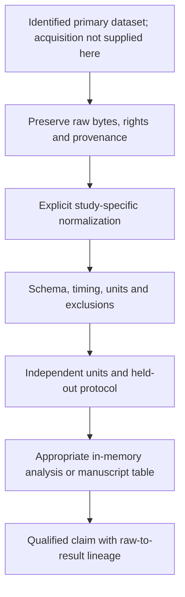

# External Ant Data: Proposed Custody and Empirical Analysis Requirements

This guide specifies a **proposed data-integration protocol**, not an implemented dataset importer or evidence that an ant dataset has been acquired. The package exposes in-memory evidence/reporting and behavioral-analysis APIs; its installed console entrypoints are `antstack-ce`, `antstack-build` and `run-all-antstack`, not an external-data acquisition/import command.

The run-all `data` task generates and copies manifest-driven CE analytical/synthetic products. Selecting `data`, `statistics` or `validation`, including `--validate-only`, does not ingest external animal records or scientifically validate a dataset. No independent raw ant or device-calibration dataset has been identified for the native CE example.



## Suggested Dataset Layout Is Not an Enforced Package Schema

For an acquired dataset, keep a self-contained custody bundle such as:

```text
data/external/<dataset_id>/
  provenance.yaml
  raw/
  derived/
  validation/
  README.md
```

This is a suggested project layout. Ant Stack does not currently create or validate this bundle as an external-dataset contract. Do not describe its paths or the candidate fields below as supported importer arguments. Implemented run-output custody is documented separately in [reproducibility](reproducibility.md).

## Provenance Must Connect Primary Records to the Exact Claim

Before describing records as empirical evidence, preserve:

- Dataset identifier/version, primary publication or repository URL, source organization, retrieval/acquisition date, license and access/use restrictions.
- Unmodified raw-input checksums and original filenames; acquisition/processing software versions; reproducible transformations and parameters; exclusions and missingness.
- Species/caste, colony and individual/session identifiers where available, experimental context and measurement modality. Mark unknown metadata as unknown rather than inventing it.
- Coordinate, time, mass, energy and spectral units as applicable; calibration factors and their uncertainty; camera/instrument resolution and synchronization.
- Independent sampling unit (animal, colony, device or session), repeated/clustered structure, treatment assignment, calibration/training split and genuinely independent held-out split.
- For energetics: wet/dry mass definition, temperature, speed, behavior, measured rails/system boundary, gross/net baseline treatment, meter calibration, sampling bandwidth and counter range/wrap assumptions.
- A raw-to-derived-to-result mapping, the exact analysis invocation/version, validation report and limitations that constrain the manuscript statement.

A DOI identifies a record; it does not certify relevance, license compatibility, schema compatibility or validity for this comparison. A published modeling study is not automatically an observational ant dataset. For example, [Active Inferants (2021)](https://doi.org/10.3389/fnbeh.2021.647732) explicitly presents *in silico* ant-foraging experiments; cite that work as modeling context, not acquired biological calibration for Ant Stack.

## Candidate Normalized Fields Depend on the Measurement Modality

These are design recommendations, not a released universal schema:

| Modality | Candidate fields and necessary context |
|---|---|
| Trajectory | `frame`, `time_s`, `ant_id`, `x`, `y`; coordinate units, origin/axes, frame rate, pixel-to-length conversion and identity-tracking uncertainty |
| Pose | Landmark identities, coordinates, confidence, units, calibration and treatment of occlusion/missing landmarks |
| Behavioral event | `event_id`, `ant_id`, `start_time_s`, `end_time_s`, `label`; observer/model provenance, label definitions and agreement/error assessment |
| Spectroscopy | Sample identity, axis/intensity units, instrument and preprocessing, blanks/standards, calibration and biological sampling context |
| Energy trace | Time axis, power or cumulative energy with units, rail/device boundary, sensor resolution, calibration and synchronization to the analyzed workload/motion |

Schema success does not establish correct species identification, reliable behavior labels, instrument accuracy or biological validity.

## Proposed Contact Events and Frame-Level Samples

An external study-specific adapter can use the following illustrative products. These filenames and columns are **not** an Ant Stack importer schema or evidence that contact detection has been implemented or validated:

| Illustrative product | Candidate fields and lineage |
|---|---|
| `ant_trajectories.csv` | `track_id`, `frame`, `x`, `y`; declared coordinate units and frame clock. Optional `vx_px_s`, `vy_px_s`, `speed_px_s` retain pixel/second units and their derivation. Record how tracking IDs map to biological `ant_id`, sessions and identity uncertainty. |
| `collisions.csv` | Event-level `event_id`, `collision_type` (`ant_ant` or `ant_object`), participant identities, `start_time_s`, `end_time_s`, `duration_s`; document classification definitions, time units and source-record references. |
| `collision_samples.csv` (optional) | Frame-level contact candidates, with frame/time, participants, candidate score or confidence when available, and an explicit event/sample join or aggregation map. These rows are not interchangeable with event-level contact counts. |

Preserve the raw samples and the reproducible rule that groups them into events: thresholds and units, gaps/occlusions, identity switches, exclusions and event-boundary uncertainty. Derive durations from the declared common clock and state the consistency tolerance. A proximity candidate or an `ant_ant` label alone does not establish a physical or biologically meaningful interaction; event counts, frame counts and independent animals/colonies remain different sampling units.

## Use Existing In-Memory APIs Without Claiming an Importer

A study-specific adapter must preserve raw bytes, normalize units and record its transformations before passing values to package APIs. No adapter or supported file-import invocation is supplied by this guide.

- [`analysis.empirical_data`](../antstack_core/analysis/empirical_data.py) provides evidence/case-study containers. Their names do not prove that observations were collected or independently replicated.
- [`analysis.veridical_reporting`](../antstack_core/analysis/veridical_reporting.py) accepts dictionaries and distinguishes `source_kind` values `unspecified`, `model`, `synthetic`, `empirical`. This label is supplied by the caller, not independently authenticated. Preserve the real acquisition provenance alongside it.
- [`cohereants.behavioral`](../antstack_core/cohereants/behavioral.py) accepts finite positive treatment/control response-time arrays. Use one declared time unit in both groups and state it in results. Its independent-group Welch test does not model paired, repeated-animal or colony-clustered designs.

The reporting `source_kind` field is separate from CE row `record_kind` and `measurement_status`; do not silently translate a model record into an empirical observation. `None`/unknown validation and unavailable inference must remain visible, not default to success. See [API contracts](public_api_contracts.md) and [scientific validation](scientific_validation.md).

## Manual Benchmark Reports From Caller-Owned Derived CSVs

The external-pipeline reporting pattern is manual, not a package acquisition/import command:

1. Produce authorized tracking/contact outputs, preserve the raw custody bundle and record the exact processing version and CSV checksums.
2. Compute declared summaries from the selected derived CSV revision: mean speed by condition/sampling unit, detections by scene/domain, ant–ant versus ant–object event counts, and any real-versus-simulated trajectory similarity with its metric, units, pairing and independent-unit definition. Retain uncertainty and missingness rather than treating frames or repeated deterministic runs as independent animals.
3. Save a static study-specific dashboard/summary image beside a CSV-derived metrics table and embed both in the intended report or manuscript section. Bind captions, table values and asset hashes to those same CSV inputs and analysis settings.

Illustrative Markdown embedding syntax only—the asset below is supplied by the study, not shipped or generated by this guide:

```markdown
### Empirical Benchmark Snapshot


```

Pair the image with the actual CSV-derived table, units, independent sample counts, provenance and limitations. A static report image does not validate tracking accuracy, contact hypotheses, empirical calibration or biological agreement.

## Proposed Empirical Acceptance Sequence

1. Acquire authorized primary records and preserve the raw custody bundle.
2. Declare the estimand, units, exclusions, dependence structure and held-out comparison before fitting parameters.
3. Normalize into derived products with reproducible study-specific transformations. Check missingness, ranges, identity consistency, monotonic timing, event intervals and label definitions; preserve paired observation masks when excluding values.
4. Record performed checks separately from unknown/unperformed ones. Fit only on declared calibration/training units, then evaluate on genuinely independent held-out units. Frames, deterministic repeats and bootstrap resamples are not independent animals or colonies.
5. Publish a qualified result with effect size, uncertainty, sample-unit counts and raw-to-result provenance. Report absent measurements/validation as unavailable, and retain failures and exclusions.

For CoT, integrate locomotion energy over the same interval as displacement and identify gross/net energy, mass and speed. The native CE mass/distance fields lack that matched locomotion interval, so its CoT remains unavailable. Do not transplant species-specific metabolism, neural power or allometry from unrelated taxa/tasks. A nominal 0.001 kg is 1 g, not 1 mg.

Software checks and generation commands belong in [validation](validation.md) and [reproducibility](reproducibility.md). They are implementation/custody probes, not proof of dataset acquisition, an implemented importer or empirical validation.
