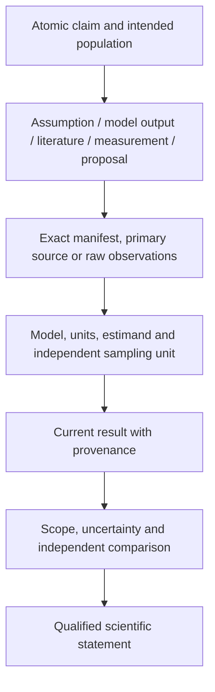

# Scientific Validation: Evidence Classes, Inference and Acceptance Boundaries

Scientific validation asks whether an identified claim is supported by appropriate inputs, methods and independent evidence. Schema checks, numerical regression tests, checksum checks and successful PDF generation address different software properties; none alone establishes biological validity, instrument accuracy or publication readiness.

## Native Results Are Analytical, Not Device or Animal Observations

The [native CE manifest](../papers/complexity_energetics/manifest.example.yaml) selects deterministic base closed-form workloads and a null meter. Workload dimensions, activity fraction, rates, energy prices and physical powers are illustrative assumptions. No independent raw ant dataset, device-calibration campaign or external replication record has been identified for that example.

The producer distinguishes `record_kind` (`analytical` or `synthetic_workload`), `compute_energy_j`, `isolated_idle_energy_j`, `energy_est_j`, `measured_energy_j` and `measurement_status`. Native rows are `analytical` and `not_measured`, with no measured energy value. A Python object named `EmpiricalEvidence`, a populated `raw_measurements` dictionary or a `source_kind="empirical"` label does not authenticate data acquisition.

Hardware telemetry is a separate capability. Closed-form workloads cannot be paired with a hardware meter in this runner; hardware measurement requires loop workloads. RAPL/NVML observations concern their instrument/device boundary, not automatically the robot, locomotion or biological metabolism. Unavailable telemetry raises `PowerMeasurementUnavailable`; it must not be recast as observed zero consumption. The null meter is explicitly disabled, not hardware fallback. See the [API contracts](public_api_contracts.md) and [theory/accounting definitions](theory.md).

## Every Claim Needs an Evidence Category and Scope

| Category | Required qualification |
|---|---|
| Assumption | Identify the configured value, units, domain and role; do not call it calibrated, optimal or species-typical without evidence. |
| Analytical or synthetic output | Identify the completed run, exact input snapshot, model family, response boundary, statistic and integration interval. |
| Literature datum | Verify the primary identity and actual population/platform, conditions and measurement boundary; attribute it rather than transferring it to this implementation. |
| Actual measurement | Preserve raw records, instrumentation, calibration context, independent units, exclusions, processing and uncertainty. |
| Proposed protocol | Use prospective language; do not report intended calibration, sensitivity or biological outcomes as completed. |

Sobol/Morris screening, Bayesian posterior calibration, error below 5%, measured critical exponents/hysteresis, topology superiority, universal real-time thresholds and species-specific CoT/neural-power comparisons are **not established** by the native workflow. Missing validation is unperformed/unknown, not success.

## Statistical Inference Requires Independent Units, Not More Repeats

The manifest requests 100 deterministic repeats and 1000 bootstrap resamples at confidence level 0.95. Repeats recalculate the same formulas; resamples reuse the supplied values. Neither is the number of independent animals, colonies, devices or sessions, and neither guarantees statistical power above 0.8. Identical values legitimately yield a degenerate bootstrap interval, not empirical precision or proof of no uncertainty.

[Efron's original bootstrap paper](https://doi.org/10.1214/aos/1176344552) starts from an observed random sample to estimate a sampling distribution. Resampling does not manufacture the independent observations or justify the sampling design. Distinguish uncertainty in input assumptions, model discrepancy, instrument error and empirical sampling variability; the native repeat intervals do not estimate all of these.

For a prospective empirical comparison:

- Declare the estimand, effect direction, independent sampling unit, treatment assignment, dependence structure and exclusions before interpreting a test. Consecutive video frames and repeated measures from one animal/colony are not independent replicates.
- Match the analysis to the design. Behavioral helpers implement an **independent-group Welch** comparison and Student-$t$ interval, not a paired or hierarchical analysis. Repeated/paired/clustered data require a suitable declared analysis outside that helper's independent-group assumption.
- Check finite/domain constraints and interpret insufficient-data, degenerate-variance and unavailable-distribution statuses. A singleton cannot estimate sample variance; constant-sample limiting outputs are not ordinary finite-degree-of-freedom inference. Missing backends do not justify substituting normal-tail approximations for small-sample Student inference.
- State confidence level, interval method, sample sizes, effect units and sign convention. General analysis Cohen's $d$ uses group2 minus group1; behavioral response differences use treatment minus control. Do not compare these signs without reconciling order.
- Preserve paired observations when plotting/filtering; apply a joint validity mask to coordinates and report exclusions. A visually plausible plot does not repair an invalid design.
- Separate prospective power planning from observed-effect normal-approximation “power” and descriptive quality scores. Neither validates a study or proves replication.

The implementation basis is [`statistics.py`](../antstack_core/analysis/statistics.py), [`statistical_analysis.py`](../antstack_core/analysis/statistical_analysis.py) and [`cohereants/behavioral.py`](../antstack_core/cohereants/behavioral.py). Tests of these methods establish implementation behavior only when actually executed and reported; this page asserts no test result.

## Reconcile Units, Windows and Models Before Comparing Energy

Use the [theory guide](theory.md) and [manuscript methods](../papers/complexity_energetics/Methods.md) for formulas and model roles. At minimum, distinguish module-isolated compute-plus-idle rows, compute-only scaling windows, common-window system estimates and actual device observations. Count shared idle once in a system sum; retain Mind physical compute. Base exact tree nodes and enhanced bounded leaf policies are not interchangeable.

The generated common window is inverse maximum configured frequency, not universally one decision for every module; flooring updates can omit slower modules in that short window. The native example has equal rates, but comparisons across configurations must expose this convention rather than infer scheduling behavior.

CoT is unavailable without matched locomotion energy and distance. Match gross/net accounting, mass definition, speed, temperature and time interval before cross-platform/species comparisons. Unit examples: 0.001 kg is 1 g; 0.50 W over 10 ms is 5 mJ. These identities do not establish a biological benchmark.

## Provenance Validation Is Distinct from Scientific and Publication Acceptance

A completed governed run uses `manifest.json` schema v2 with `complete`, `generation_id`, task selection, and artifact records containing relative `path`, `checksum`, `bytes` and `content_identity`. Input snapshots, dependency/source metadata and current-invocation inventories make results traceable. They bind bytes and execution context, not scientific truth or independently reproduced results. In particular, `validation_summary.json` covers artifact completeness/current byte integrity, not biological validity.

Use [reproducibility](reproducibility.md) for generation and custody, [software validation](validation.md) for owner-run checks, and [external-data integration](external_ant_data_integration.md) for empirical prerequisites. Do not duplicate those procedures in a scientific claim.

Actual full three-paper rendering and visual review are recorded in [manuscript provenance](../papers/manuscripts.provenance.json) and [manuscript status](manuscript/MANUSCRIPT_STATUS.md). Those source-bound software/publication observations do not close the empirical gaps above. Conceptual graphical exports are not numerical results; canonical checksums do not establish biological validity. Local sandbox/font failures remain distinct from the successful Linux render, and live release state remains a separate observation.
