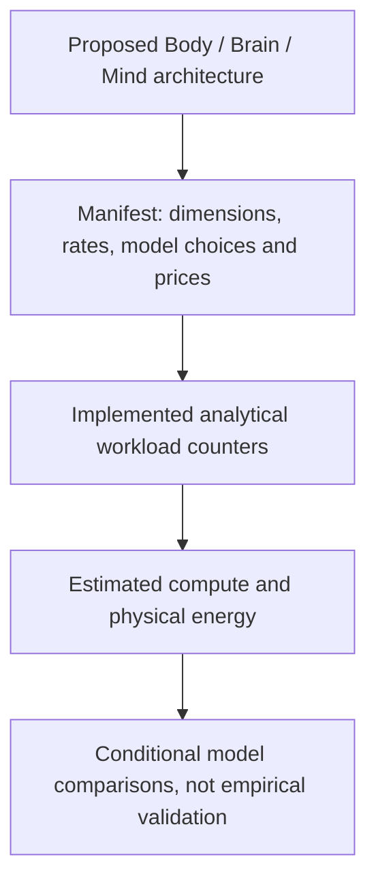

# Analytical Workload Theory and Physical Accounting

Ant Stack separates a **proposed** embodied architecture into Body, Brain, and Mind, then implements counter-based models of hypothetical work and energy. The layer names do not denote a functioning ant emulation: no integrated MuJoCo/FlyBody robot, complete active-inference agent, or closed colony sensorimotor loop is demonstrated by these workloads.

## Base Counters and Enhanced Models Answer Different Questions

The native [CE manifest](../papers/complexity_energetics/manifest.example.yaml) selects the **base** closed-form functions through [`CLOSED_FORM_WORKLOADS`](../antstack_core/orchestration/complexity_energetics.py). The implementations are in [`analysis/workloads.py`](../antstack_core/analysis/workloads.py); [the manuscript methods](../papers/complexity_energetics/Methods.md) document their detailed formulas.

| Layer | Selected base-model interpretation | What the counters do not establish |
|---|---|---|
| Body | Contact, sensor-processing and control work; supported contact conventions are `pgs`, `si`, `ldlt` | Solved physical trajectories, contact accuracy, convergence or a measured solver ranking |
| Brain | Activity-dependent neural work, channel processing and traffic; supported patterns are `random`, `structured` | An ant connectome, biological firing statistics, learned task performance or topology superiority |
| Mind | Work proportional to exact tree nodes, state/action dimensions and precision iterations | Executed belief updates, successful policy selection or a universal tractability threshold |

For base Mind, canonical `B` is the branching factor and `H_p` is a horizon in **decision steps**, with

$$N_{\mathrm{tree}}=\sum_{h=0}^{H_p}B^h.$$

This counts nodes including the root. It is not the separate enhanced Mind model's leaf-policy count:

$$P=\min(B^{H_p},M),$$

where finite `max_policies=M` defaults to 1000; `None` requests $P=B^{H_p}$. Enhanced Body/Brain also use different component formulas and memory splits. Neither the word “enhanced” nor bounding the policy count demonstrates greater biological fidelity, preserved decision quality, or measured acceleration. Identify the family and parameters whenever comparing outputs; do not use an enhanced per-decision helper to explain a base sweep.

## Update Counts, Traffic and Configured Time Bases

For nonnegative duration $t$ and positive frequency $f$, the closed-form workloads multiply per-update counters by $n=\lfloor ft\rfloor$. Counts/dimensions have integer domains, activity fraction `rho` lies in $[0,1]$, and physical inputs must be finite and within their declared domains. A validated domain is a software constraint, not evidence that a parameter describes an animal or device.

Byte counters are **modeled traffic over updates**, not automatically peak resident memory. Memory-hierarchy fractions, operation multipliers and spike rates are assumptions in the formulas. At nominal 100 Hz, a 0.5 s window contains 50 modeled updates and a 10 ms window contains one. Configuring 100 Hz does not demonstrate real-time scheduling or a measured 10 ms execution time.

The generated common-window table uses $\Delta t=1/\max(f_i)$ and the selected workload functions. It represents one decision only for modules running at that maximum frequency. At unequal rates, flooring can give slower modules zero updates in that window; the table is not a multirate scheduler or a long-run average energy budget.

## Joules Require Explicit Prices and Matched Boundaries

[`estimate_compute_energy`](../antstack_core/analysis/energy.py) prices FLOPs, SRAM/DRAM traffic and spikes:

$$E_{\mathrm{compute}}=10^{-12}(N_F e_F+V_S e_S+V_D e_D)+10^{-18}N_{\mathrm{spk}}e_{\mathrm{spk}}.$$

FLOP/byte prices are in pJ per counted unit; the spike price is in aJ per event. Baseline energy is $E_0=P_0t$. These coefficients are illustrative assumptions in the native manifest, not calibrated hardware prices. The separate actuation/sensing estimates integrate assumed power over a window; they do not simulate a gait or measure locomotion. Mind computation has physical energy costs regardless of its symbolic interpretation.

Distinguish the producer's accounting boundaries:

- **Raw module-isolated rows:** compute plus that module's idle over its workload window, excluding locomotion. Do not sum these baseline-inclusive rows as shared-controller system energy.
- **Scaling plots:** compute-only energy over a configured 0.25 s analysis window, not the raw 0.5 s workload row.
- **Common-window system table:** selected compute models, separate assumed actuation/sensing and **one** shared idle baseline over $\Delta t$.

For $n>0$, divide window energy by $n$ for energy per modeled update and by $t>0$ for average modeled power. For example, 0.50 W over 10 ms is 5 mJ. A mass of 0.001 kg is 1 g, not 1 mg; the native manifest's `mass_kg: 0.02` is nominal engineering context, not species data.

Dimensionless cost of transport uses $E/(mgd)$, with energy and displacement from the **same locomotion interval** and a declared gross/net energy boundary. The CE producer has no such matched interval, so CoT is unavailable even though nominal mass and distance fields exist.

## Scaling Fits and Thermodynamic References Have Limited Scope

Log–log regression describes a finite-range power model $y=ax^b$ on positive finite paired values. A fitted exponent is not evidence of an exponential law, biological allometry, a phase transition or hysteresis. A constant response has undefined variance-based $R^2$, not a perfect validated fit. Inverse-parameter illustrations are proxies, **not Pareto frontiers** or measured performance objectives.

[Landauer's original paper](https://doi.org/10.1147/rd.53.0183) concerns irreversible information processing. [Bérut et al. (2012)](https://doi.org/10.1038/nature10872) experimentally studied erasure in a one-bit colloidal memory. Their scope does not turn $k_BT\ln 2$ into a per-FLOP device price: a workload bound requires explicit erased-bit and temperature assumptions. [Carnot's heat-engine argument](https://www.numdam.org/item/10.24033/asens.88.pdf) is not a general actuator-efficiency ceiling. Variational/expected free energy in active-inference models is not automatically thermodynamic energy in joules.

[Active Inferants (2021)](https://doi.org/10.3389/fnbeh.2021.647732) provides an *in silico* ant-foraging modeling example, not empirical calibration or implementation evidence for this repository's proposed architecture.

## Trace Numerical Claims to One Completed Run

The numerical input authority is the manifest; model selection and formulas are package-owned. Use `Generated.md`, CSV, summary and identified assets from one completed run rather than hand-maintained duplicate results. Direct CE products stay beneath fresh `--out`; governed results live under `outputs/<run_id>/`, with explicit compatibility projection rather than source-tree inference.

Deterministic repeats and bootstrap resamples do not create independent observations or calibration. See [scientific validation](scientific_validation.md) for inference boundaries, [external-data integration](external_ant_data_integration.md) for proposed empirical custody, and [reproducibility](reproducibility.md) for the shared run/provenance contract.
