# Analytical Complexity and Energy Results

These are analytical/synthetic workloads, not independent biological or hardware observations.

## Per-Workload Estimated Energy

Each row includes that module's compute and isolated idle over its workload duration. These isolated rows must not be summed as a system total; locomotion is excluded.

| Workload | Mean (J/window) | 95% CI Low | 95% CI High | N |
|---|---:|---:|---:|---:|
| body | 0.25000291 | 0.25000291 | 0.25000291 | 100 |
| brain | 0.25004641 | 0.25004641 | 0.25004641 | 100 |
| mind | 271.14218 | 271.14218 | 271.14218 | 100 |

## Figure: Module-Isolated Energy {#fig:energy_by_workload}

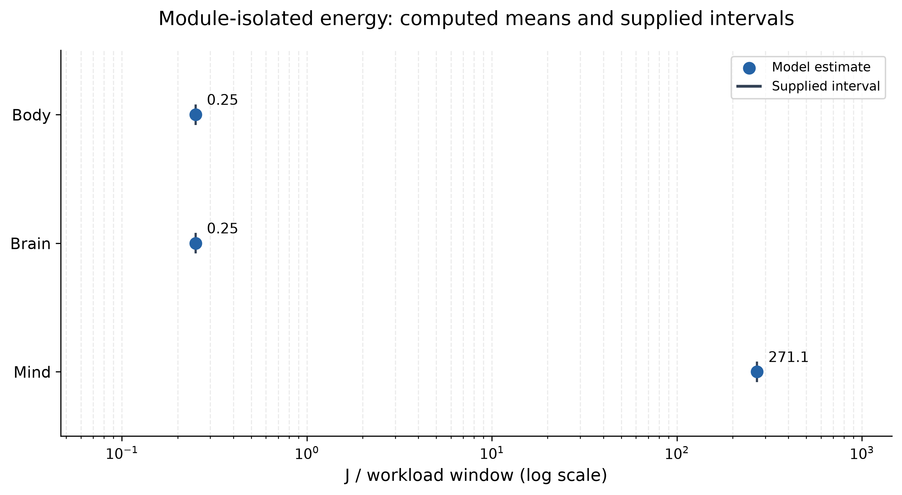

## Figure: Body configured compute curves {#fig:scaling_body_J}

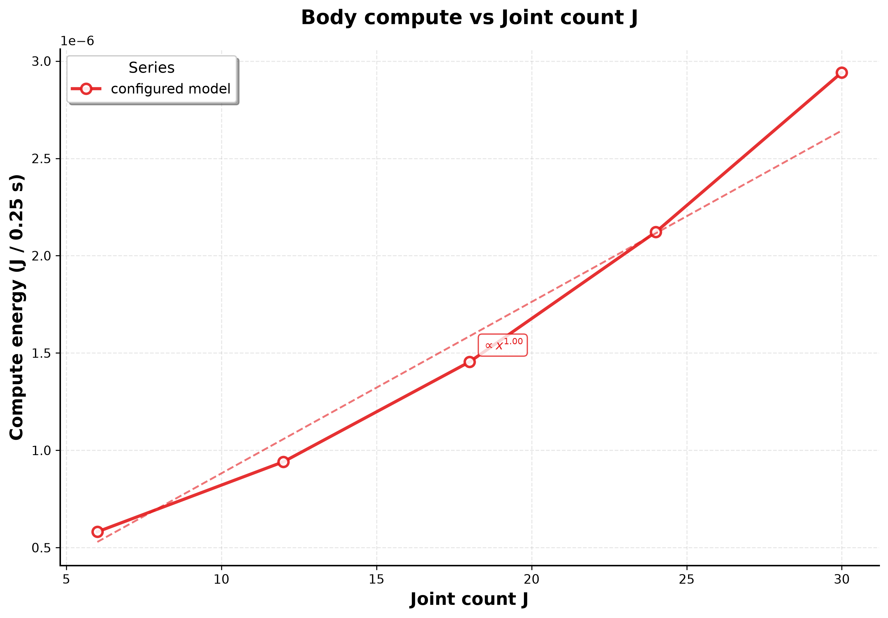

## Figure: Body lowest configured compute points {#fig:scaling_body_J_scatter}

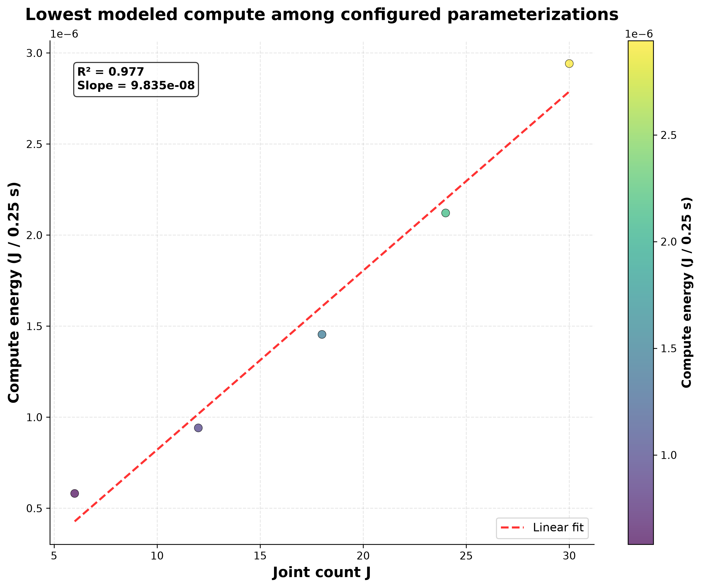

## Figure: Body inverse-parameter illustration {#fig:inverse_parameter_body_J}

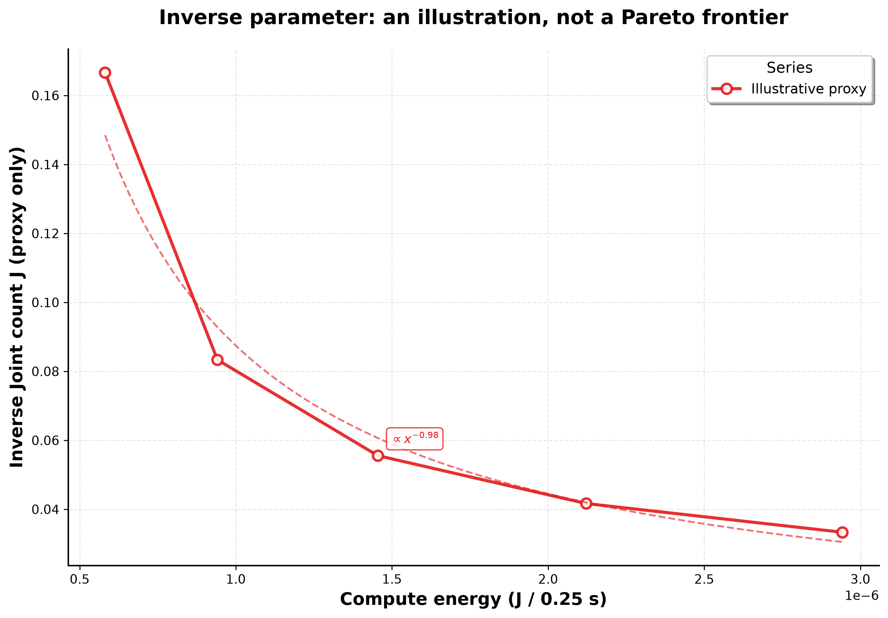

## Figure: Brain configured compute curves {#fig:scaling_brain_K}

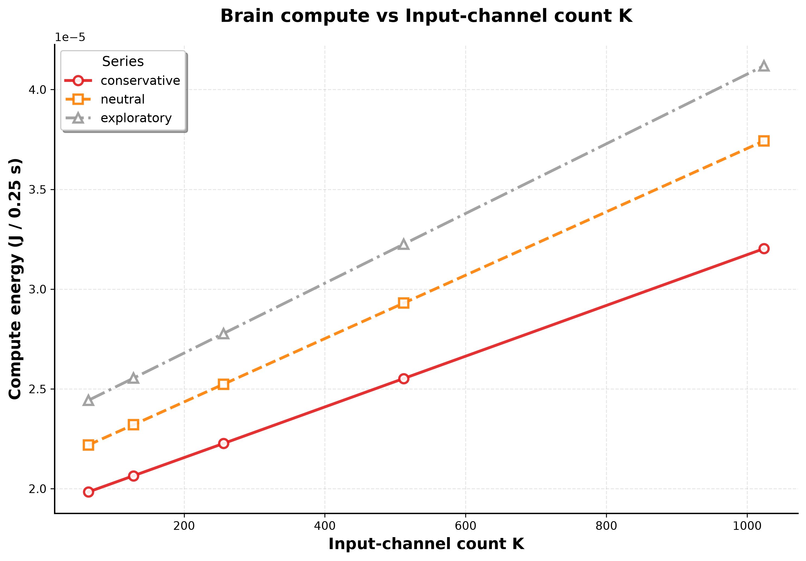

## Figure: Brain lowest configured compute points {#fig:scaling_brain_K_scatter}

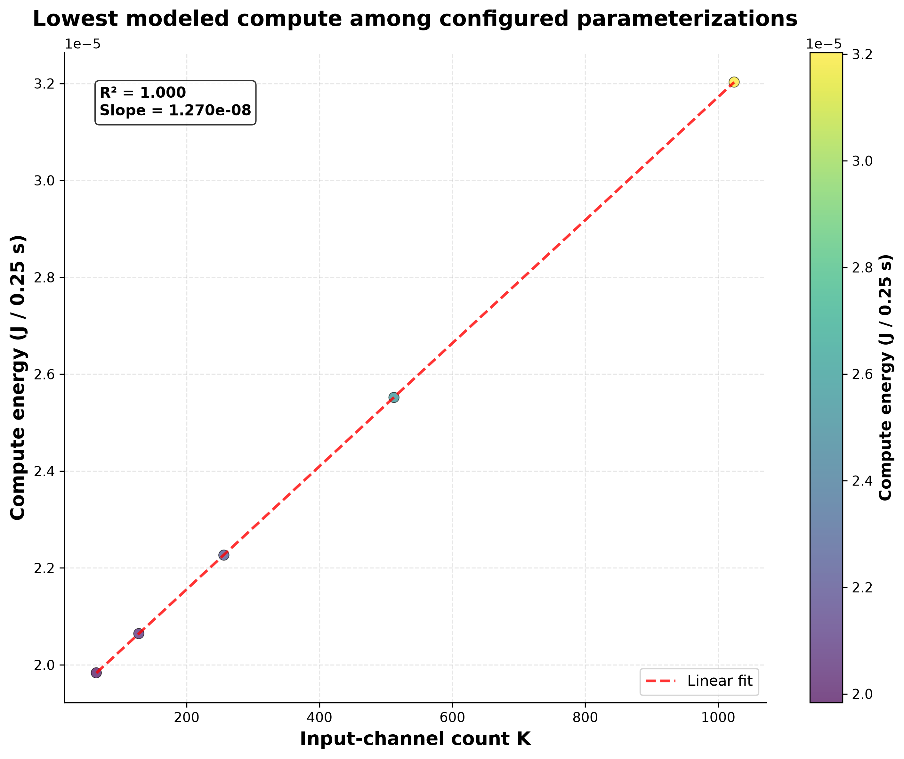

## Figure: Brain inverse-parameter illustration {#fig:inverse_parameter_brain_K}

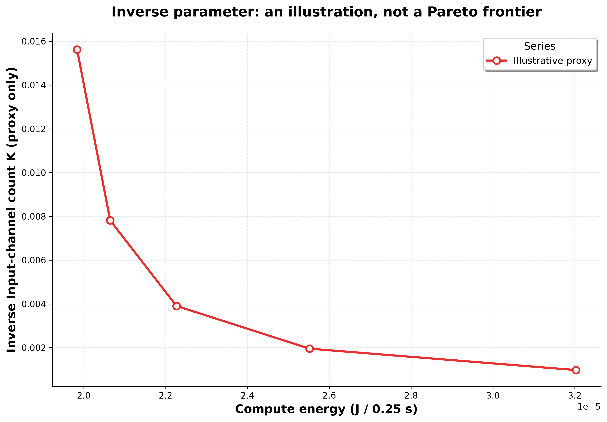

## Figure: Mind configured compute curves {#fig:scaling_mind_H_p}

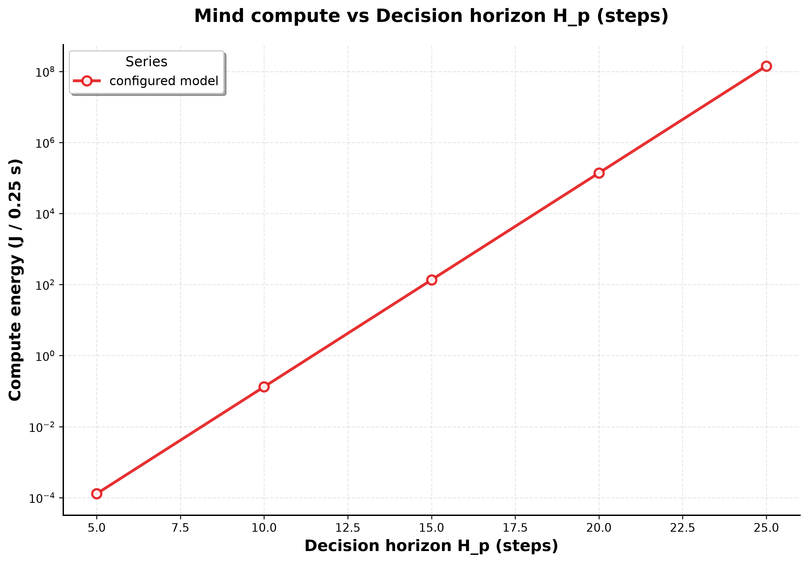

## Figure: Mind lowest configured compute points {#fig:scaling_mind_H_p_scatter}

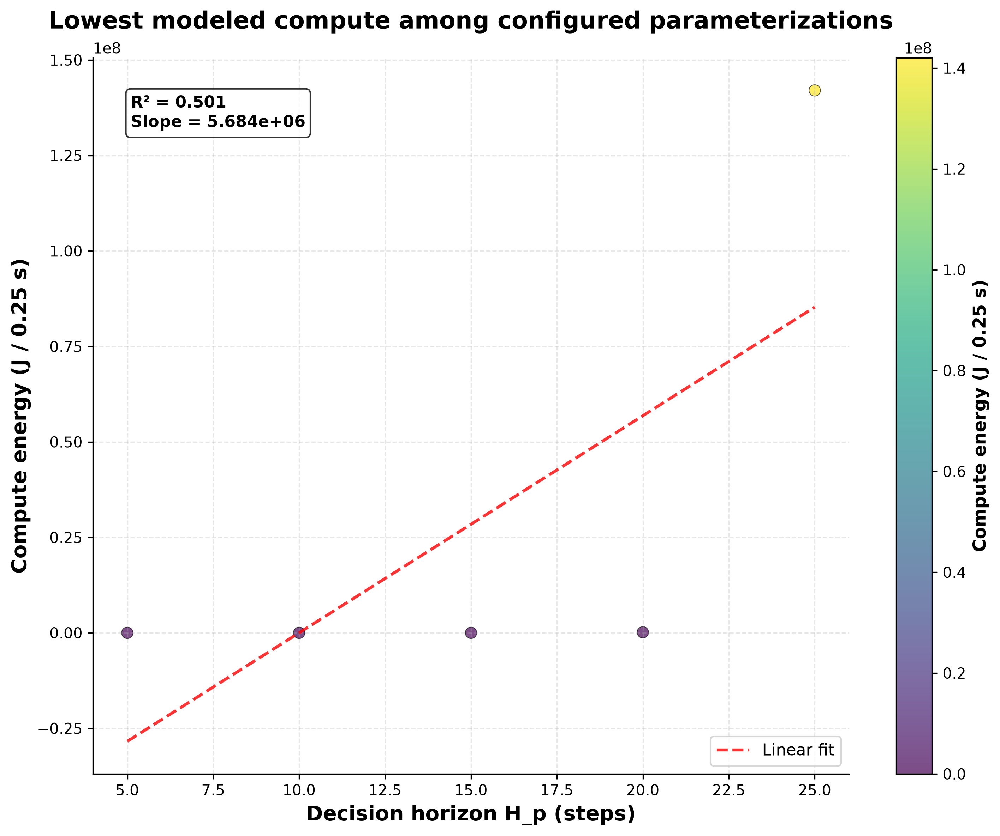

## Figure: Mind inverse-parameter illustration {#fig:inverse_parameter_mind_H_p}

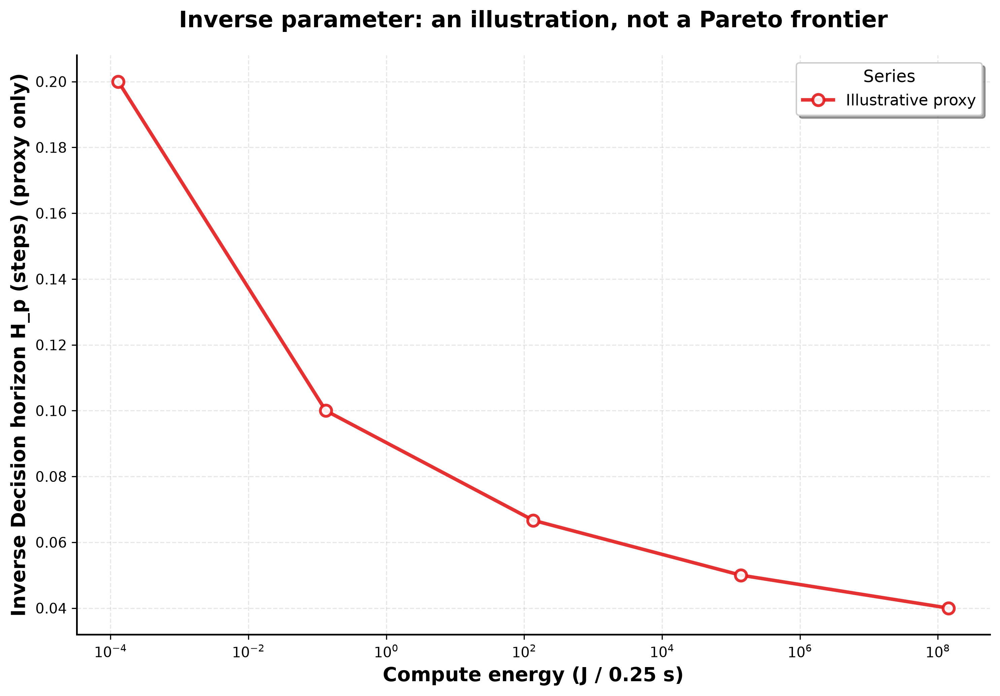

## Figure: Body Energy Partition {#fig:body_partition}

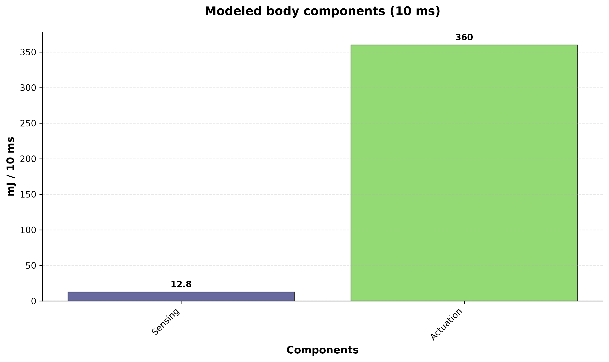

## Figure: Common-Window Compute Accounting {#fig:per_decision}

| Component | Energy (mJ / 10 ms) |
|---|---:|
| body | 5.817664e-05 |
| brain | 0.0009281049 |
| mind | 5417.8436 |
| Body actuation | 360 |
| Body sensing | 12.8 |
| Shared idle | 5 |
| Modeled system total | 5795.6445 |

## Table: Common-Window Complexity {#tab:complexity_per_decision}

| Workload | FLOPs / 10 ms | SRAM bytes / 10 ms | DRAM bytes / 10 ms | Spikes / 10 ms |
|---|---:|---:|---:|---:|
| body | 26320 | 6246.4 | 1561.6 | 0 |
| brain | 23619.778 | 389491.2 | 43276.8 | 100 |
| mind | 3.8883771e+12 | 1.7637999e+11 | 7.5591425e+10 | 0 |

## Cost of Transport

Unavailable: compute-window energy is not locomotion energy, and no matching modeled locomotion interval/distance is supplied by this producer.

## Raw Results

[Results CSV](../papers/complexity_energetics/out/results.csv)
