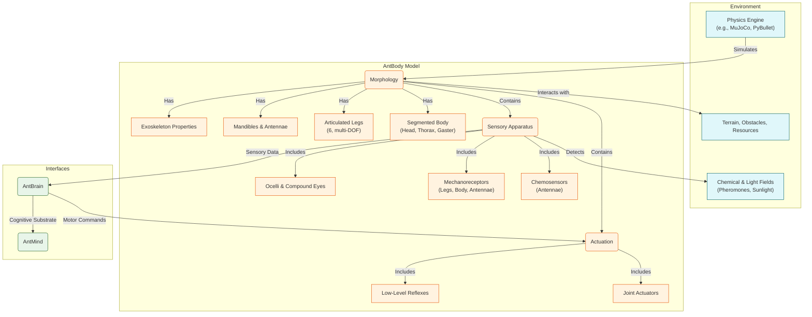

# AntBody: Proposed Morphology and Sensorimotor Interfaces {#antbody}

The proposed `AntBody` would couple morphology, biomechanics, actuation, and sensors through explicit interfaces. `FlyBody` and MuJoCo provide design references; this repository does not implement a FlyBody-to-ant adapter, a MuJoCo/PyBullet dynamics solver, or an executed sensorimotor stream. Its implemented Body workload functions estimate analytical operation counts and assumed energy costs. Reproducing ant contact dynamics, gradient sensing, and actuation latencies remains an evaluation objective.

## Morphology and Biomechanics

- **Segmented body:** Head, thorax, gaster with articulated joints.
- **Six articulated legs:** Multiple degrees of freedom (DOF) per leg for tripod gait and uneven terrain.
- **Mandibles and antennae:** Grasping/manipulation; near-field chemosensation.
- **Exoskeleton properties:** Rigidity and mass distribution for realistic contact.
- **Thermoregulation & hydration:** Optional environmental coupling for temperature and humidity tolerance experiments.

## Actuation and Motor Control

- **Joint actuators:** Muscle-like force generation per joint.
- **Low-level control:** Reflexive stabilization (e.g., stance) beneath `AntBrain` commands; optionally PID/impedance at joints for robust terrain contact.

## Sensory Apparatus

- **Chemosensors:** Antennal channels detect pheromone gradients and absolute concentration.
- **Mechanoreceptors:** Leg/body/antennal contact, forces, joint angles/velocities.
- **Ocelli/compound eyes:** Ambient luminance, polarized-light compass, low-res motion/landmarks.
- **Auditory/vibration (optional):** Substrate-borne vibration sensing for alarm/communication experiments.

Goal: a functionally accurate ant nestmate body posing the same control problems a real ant brain evolved to solve.

## Proposed Interfaces (I/O Contract)

All rates, latency/drift budgets, step sizes, and noise ranges below are engineering assumptions or acceptance targets, not measured performance or species-specific data.

- **Observation o_t ($100\,\mathrm{Hz}$; SI units unless noted):**
  - Chemosensors: K channels/antenna, normalized [0,1]; gradient and absolute concentration
  - Mechanoreceptors: per-leg contact (bool), ground reaction forces (N), joint angles (rad), joint velocities (rad/s)
  - Vision: ocelli luminance (normalized), optional optic flow (px/s), polarized-light compass (deg)
  - IMU (optional): linear acceleration (m/s^2), angular velocity (rad/s)
- **Action a_t ($100\,\mathrm{Hz}$):**
  - Joint targets: position (rad) or torque (N·m) per DOF (configurable)
  - Mandible aperture (rad), antennae joint targets (rad)
- **Timing:** Physics step $\Delta t = 1$ ms; control loop acts every 10 steps ($100\,\mathrm{Hz}$)
- **Latency budget:** End-to-end sensor$\to$actuator latency target $\le 20$ ms (configurable)
- **Synchronization:** Monotonic timebase; max drift between body and brain clocks $\le 2$ ms; timestamp every observation

Strict units and update rates enable drop-in replacement of bodies and simplify benchmarking across engines.

## Configuration Assumptions and Illustrative Defaults {#configuration}

- Dynamics: position or torque control
- Terrain: flat, rough, slope
- Sensor noise: Gaussian $\sigma$ per channel
- Pheromone field: on/off, diffusion $D$, decay $\lambda$
- Energy model (optional): per-actuator energy and baseline metabolism for efficiency metrics
- Contact/friction: Coulomb friction coefficients ($\mu_s, \mu_k$) and restitution per material
- Proposed sensor/actuator calibration inputs: per-channel offset/gain and instrument logs; no completed auto-calibration campaign is claimed.
- Batch mode: offline rollout/export of o_t, a_t, and internal state for dataset generation

Illustrative assumed defaults: 3–4 DOF per modeled leg, physics step $\Delta t=1$ ms, 100 Hz control, Gaussian normalized-channel noise $\sigma\in[0.01,0.05]$. Stability and task suitability require evaluation; these are not physiological measurements.

### Section Summary

- Proposed physics/sensing substrate with explicit I/O targets and units
- Low-level stabilization and robustness require implemented-controller evaluation
- Parameterized terrain, control, noise, and stigmergy for reproducible experiments

## Further Technical Notes and References

- **Dynamics and engines:** [MuJoCo](https://mujoco.org/) and [PyBullet](https://pybullet.org/wordpress/) are possible simulation tools; a 1 ms step and 100 Hz control are proposed settings, not universal stability guarantees or benchmarks from those tools.
- **Leg kinematics and gaits:** Three or four modeled DOF per leg is an engineering design option, not a calibrated ant morphology.
- **Sensory/navigation context:** [Seelig and Jayaraman (2015), Neural dynamics for landmark orientation and angular path integration](https://doi.org/10.1038/nature14446), studies fly heading circuitry. It is not ant-specific evidence or proof of this controller's timing.
- **Pheromone field:** Diffusion–decay is a proposed environment abstraction; specify space/time units, deposition, boundary conditions and numerical stability before using it to infer biological behavior.
