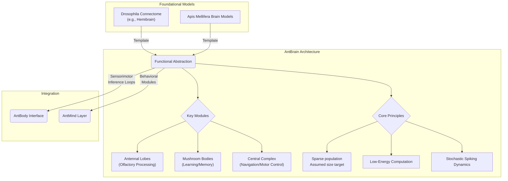

# AntBrain: Proposed Insect-Inspired Neural Abstractions {#antbrain}

`AntBrain` is a proposed functional abstraction inspired by insect neural architecture. Circuit-, cell-, and synapse-level descriptions below specify design choices, not an implemented ant connectome or demonstrated adaptive behavior. The package implements analytical sparse-processing workload counters; independent neural dynamics, learning, and navigation implementations and their validation remain necessary.

The proposed architecture draws inspiration from mapped insect brains, with functional AL/MB/CX abstractions. It does not supply an ant-specific connectome or validate cross-species mappings. Neuron populations, rates, and sparse activity below are configurable engineering assumptions/targets, not measured biological parameter estimates.

## Scope and Assumptions

- Functional, not synapse-accurate; modules align to conserved circuits (AL, MB, CX)
- Proposed 100 Hz closed loop and population range of $10^5$–$2.5\times10^5$ modeled neurons are engineering targets; no timing, energy, or species fidelity is demonstrated by those choices
- Local learning (e.g., STDP) with simple modulatory signals; no global backprop
- Noise is a feature: stochasticity aids exploration and regularization; parameters expose variance at module boundaries

## Template Resource: Virtual Fly Brain (VFB)

[Virtual Fly Brain (About)](https://www.virtualflybrain.org/about/) is an interactive resource for exploring the neuroanatomy, neuron connectivity, and gene expression of Drosophila melanogaster. It integrates curated literature and image datasets onto a common brain template, enabling cross-search, similarity queries, and 3D comparison of neurons and regions.

VFB can guide region nomenclature and source discovery. Any transfer of its fly data to ant parameters needs an explicit biological justification; no validated ant species override is demonstrated here.

## Design Principles

### 1. Functional Emulation

Simulate functional roles of key structures rather than replicate every neuron. Favor minimal sufficient mechanisms with measurable interfaces.

### 2. Neural Sparsity and Energy-Efficiency Targets {#neural-sparsity-and-efficiency}

- **Population size:** About 250,000 is an illustrative design target, not a measured or universal ant neuron count
- **Optimization:** Low-energy computation and sparse representations
- **Dynamics:** Stochastic spiking and local learning (Hebbian, STDP)
- **Neuromodulation:** Reward/aversive signals (dopamine, octopamine, other biogenic amines) gate plasticity and policy bias
  with per-task schedules exported for reproducibility

### 3. Integration

- **Sensorimotor loops:** Tight closed loop with `AntBody`
- **Behavioral modules:** Substrate for higher-level programs orchestrated by `AntMind`
- **Multi-modal fusion:** AL/MB olfaction with visual/vestibular cues into CX heading and action channels
  with a proposed 100 Hz closed-loop target whose stability/latency must be evaluated

## Proposed Implementation Choices and Timing Targets {#implementation-notes}

- Engine: spiking (Brian2 / Nengo / SpikingJelly) or hybrid rate-based
- I/O: map `AntBody` observations to AL$\to$MB$\to$CX; policy head drives CX motor channel
- Proposed interfaces should expose typed values and unit metadata; end-to-end compatibility requires evaluation.
- **Cross-module timing targets:** AL/MB at 100 Hz and CX at 50–100 Hz are proposed rates, not measured throughput.
- Learning:
  - MB: sparse coding (Kenyon cells); local plasticity with reward/punishment gating
  - CX: ring-attractor heading; soft WTA for action selection
- Targets: configured populations of $10^5$–$2.5\times10^5$, sparse activity, and nominal 100 Hz closed loop; none is a measured performance result
- **Memory:** short-term eligibility traces; long-term synaptic consolidation checkpoints for reproducibility; model cards documenting learning rules and seeds
 - Neuromodulation API: dopamine/octopamine gating channels exposed via a minimal interface for reproducible learning schedules
 - Footprint reporting: track neuron counts, parameter sizes, and update rates per module

### Technical Pointers and References

- **Antennal Lobe (AL):** Fly early olfactory processing; Wilson (2013), [Early Olfactory Processing in Drosophila: Mechanisms and Principles](https://doi.org/10.1146/annurev-neuro-062111-150533).
- **Mushroom Bodies (MB):** Fly connectivity context; Caron et al. (2013), [Random convergence of olfactory inputs in the Drosophila mushroom body](https://doi.org/10.1038/nature12063).
- **Central Complex (CX):** Fly heading context; Seelig and Jayaraman (2015), [Neural dynamics for landmark orientation and angular path integration](https://doi.org/10.1038/nature14446).
- **Efficient Spiking Simulation:** Brian2 ([docs](https://brian2.readthedocs.io/)), Nengo ([site](https://www.nengo.ai/)), SpikingJelly ([GitHub](https://github.com/fangwei123456/spikingjelly)).
- **Virtual Fly Brain (VFB):** Structural templates and nomenclature ([about](https://www.virtualflybrain.org/about/)).

These are anatomical and simulation resources, not evidence that this architecture meets its proposed 100 Hz loop or energy targets. The companion CE counter model supports only `random` and `structured` patterns, not a calibrated biological topology.

## Key Neural Circuits and Their Functions

While a full connectome is absent, we can model the primary functions of key, conserved insect brain regions.

- **Antennal Lobes (AL):** This is the first-order olfactory processing center. It receives input from chemosensors on the antennae and organizes odor information into a combinatorial code. Different odors evoke unique patterns of glomerular activation, forming a "scent signature" that is passed to higher brain centers.
- **Mushroom Bodies (MB):** The MB is a critical center for associative learning and memory, homologous to the hippocampus in vertebrates. It receives processed olfactory information from the AL and integrates it with other sensory modalities and internal state information. Its sparse coding scheme, enforced by a large number of Kenyon cells, is ideal for forming and storing specific memories, such as linking an odor to a food reward or a threat.
- **Central Complex (CX):** This is a highly-structured region crucial for spatial navigation, goal-directed behavior, and action selection. It integrates sensory cues (especially visual information like polarized light for sky-compass navigation) to maintain a representation of the ant's heading and orientation relative to its environment. It plays a key role in translating high-level goals (e.g., "return to the nest") into specific directional motor commands.

### Selected References

- See `Resources.md` for core literature on insect brain organization and active inference, and for datasets/tools (e.g., VFB) used to template modules.

### Neural Design Assumptions and Integration Targets

- Compact, biologically grounded AL$\to$MB$\to$CX control stack with sparse coding and local plasticity
- Tight interfaces with `AntBody` (sensorimotor) and `AntMind` (policy/context)
- Efficiency and configurability prioritized over full connectomic fidelity
