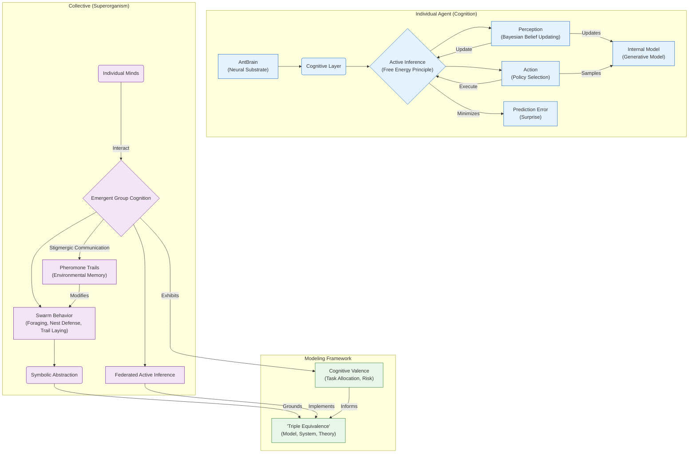

# AntMind: Conceptual Active Inference and Stigmergic Coordination {#antmind}

`AntMind` is the proposed cognitive layer linking `AntBrain` abstractions to policy selection and collective coordination. The equations and interfaces specify hypotheses for individual and colony behavior; the package does not execute active-inference decisions or demonstrate colony-level cognition. Whether unchanged local rules scale from one agent to a colony is a testable design hypothesis, not a result established here.

## Scope and Assumptions

- Active Inference links perception and action via a compact generative model
- Symbolic abstraction emerges from grounded sensorimotor predictions
- Colony cognition uses stigmergy and sparse sharing; no centralized controller
- Proposed short horizons (up to 2 s) are design choices, not demonstrated tractability. The CE model's $H_p$ instead denotes decision steps; converting to seconds requires a specified planning-step duration.

## Key Concepts

### Individual Cognition: Active Inference

- **Predictive processing:** Perception updates a generative model to reduce prediction error
- **Free Energy Principle:** Actions minimize expected free energy over time
- **Symbolic grounding:** Symbols emerge from sensorimotor predictions (supports the “triple equivalence”)
- **Risk sensitivity:** Preferences encode risk/ambiguity attitudes; policy selection trades off exploration vs exploitation

### Collective Cognition Hypothesis: Stigmergy {#collective-intelligence-emergence-via-stigmergy}

- **Stigmergy:** Environmental traces (pheromones) coordinate behavior; the trail is the memory
- **Distributed cognition:** Memory, decision-making, and learning are shared across agents and environment
- **Footprint target:** Population size is configured in the neural design, not a universal 250,000-neuron fact or evidence of emergent intelligence.
- **Resilience hypothesis:** Environmental memory and local priors may support recovery from deception; adversarial task evaluation is required.

### Proposed Symbolic Grounding from Sensorimotor Predictions {#from-sub-symbolic-to-symbolic-cognition}

The stack offers a pathway from sub-symbolic processing to symbolic reasoning via grounded predictions. Symbols are treated as compressed, re-usable predictions tied to tasks and sensory contexts.

## Proposed Single-Agent Generative Model {#minimal-generative-model-single-agent}

- Latent state s_t: pose, heading, internal drive (hunger), local pheromone expectation
- Observation o_t: from `AntBody` I/O
- Action a_t: joint targets
- Preferences: priors over outcomes (food proximity↑, energy cost↓, collision↓)
- Constraints: energy budget and temperature/humidity limits (optional) shape expected free energy
- Proposed update: variational inference and policy selection over an illustrative 0.5–2.0 s horizon; this is not measured task performance.
- Proposed rates: control at 100 Hz and policy update at 10 Hz, not demonstrated device throughput.
- Diagnostics: report expected free energy terms (risk, ambiguity), action entropy, and policy dwell time
 - Diagnostics: report EFE decomposition (epistemic/pragmatic value), action entropy, policy dwell time, and constraint violations

## Proposed Diffusion–Decay Pheromone Field {#pheromone-field-stigmergy}

- A proposed explicit field update is $c_{t+1}=(1-\lambda\Delta t)c_t+D\Delta t\nabla_h^2 c_t+q_t$, with time step $\Delta t$, spatial discrete Laplacian $\nabla_h^2$, and deposits $q_t$ in concentration units.
- Specify $D$ in area/time, $\lambda$ in inverse time, grid spacing, boundary conditions, nonnegativity, and stability. Reward-linked deposits are a modeling choice, not a measured pheromone law.
- Agents follow $\nabla$c; following probability rises with |$\nabla$c|
- Interfaces: deposit/read operations are unit-aware; decay and diffusion are version-pinned for replication
 - Stability: saturation/clipping on c_t and deposit rates to prevent runaway trails; optional anisotropic diffusion under wind

### Technical Pointers and References

- **Active inference foundations:** Friston et al. (2015), [Active inference and epistemic value](https://doi.org/10.1080/17588928.2015.1020053).
- **Ant-colony modeling context:** Friedman et al. (2021), [Active Inferants: An Active Inference Framework for Ant Colony Behavior](https://doi.org/10.3389/fnbeh.2021.647732), is an in-silico foraging model, not validation of this architecture or a specific ant neural mechanism.
- **Stigmergy and Ant Trails:** Canonical formulations in ant optimization and diffusion-decay fields ([Ant colony optimization](https://en.wikipedia.org/wiki/Ant_colony_optimization_algorithms), [Fick’s laws of diffusion](https://en.wikipedia.org/wiki/Fick%27s_laws_of_diffusion)).

Conceptual symbolic processing does not eliminate physical compute energy. Policy evaluation must be counted on the hardware where it runs. Base CE Mind uses canonical $B,H_p$ and exact tree-node enumeration; enhanced Mind is a separate bounded leaf-policy model (`max_policies=1000`, or `None` for exact enumeration). No universal 15-step timing boundary or quality-preserving sampling result is established.

## Proposed Colony-Level Arbitration {#colony-level-arbitration}

- Federated active inference: local beliefs shared sparsely via stigmergy; no central controller
- Task allocation: soft constraints via internal drives and pheromone-mediated opportunities
- Safety: monitor for deceptive gradients; trigger re-exploration and attenuate deposit under conflict
 - Belief sharing: lossy compression of shared statistics (e.g., recent reward rates, local gradient summaries)

### Section Summary

- Cognitive bridge from neural substrate to behavior and collective intelligence
- Minimal, testable generative model with explicit stigmergy dynamics
- Small-footprint policies that compose across agents
