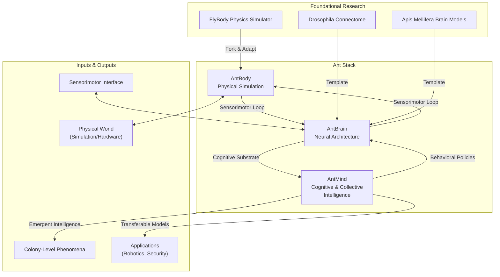

# The Ant Stack

The Ant Stack is a proposed compact, modular architecture for studying embodied agents through body, brain, and mind layers. It emphasizes explicit interfaces and insect-inspired abstractions. Biological plausibility, low-power operation, robustness, and transfer to hardware remain hypotheses to evaluate, not demonstrated properties of a complete ant emulation.

The framework is composed of three primary layers: `AntBody`, `AntBrain`, and `AntMind`. This structure allows for a separation of concerns, where physical simulation, neural architecture, and cognitive modeling can be developed and studied independently while remaining interoperable. The goal is to build upon foundational research in other insects, such as *Drosophila* and *Apis*, to accelerate the development of a sophisticated ant model with wide-ranging applications.

## Proposed Research Directions

- Evaluate `AntBody` I/O, `AntBrain` AL–MB–CX abstractions, and `AntMind` generative-model/stigmergy choices with explicit task metrics.
- Establish source-backed species parameter sets and independently reproducible protocols before claiming species fidelity or one-click empirical replication.
- Contributions welcome via pull requests. Keep edits small; include seeds, units, and benchmarks. Propose task variants aligned with the evaluation suite.

## Conceptual Contribution and Evaluation Boundary {#ant-stack-summary}

The conceptual decomposition supplies a way to formulate testable models of sensorimotor and collective behavior. The companion CE workflow analyzes assumed workload counters, not a completed end-to-end neural/physical ant simulation. All numerical design targets require independent timing, task, and energy evaluation before deployment or scientific validation claims.
