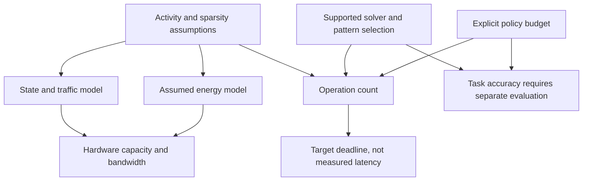
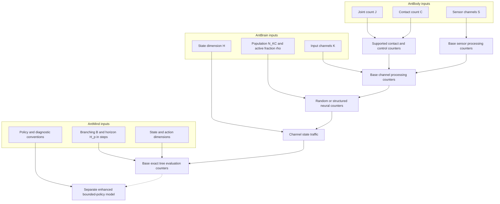

# Analytical Operation-Count and Memory-Traffic Models {#complexity-analysis}

## Workload Assumptions and Unverified Timing Targets {#theoretical-framework-and-timing-targets}

We analyze operation-count and traffic models, not executed contact solvers or biological neural circuits. Asymptotic time, modeled byte traffic, and energy estimates are distinct from wall-clock latency and peak storage. A nominal 100 Hz decision rate implies a 10 ms scheduling target; meeting it requires profiling and deadline evidence on named hardware.

Parameterized formulas are useful for identifying which dimensions drive work. They do not establish a formal fixed-parameter-tractability classification, solver accuracy hierarchy, or hardware-independent feasibility boundary. In particular, neither 20 contacts, activity fraction 0.02, nor horizon 15 is a measured critical point.

## Figure: Complexity Trade-offs in Embodied AI {#fig:complexity_tradeoffs}

**Caption:** Conceptual trade-offs between modeled work, hardware constraints, and unmeasured task quality. Algorithm and budget choices do not by themselves demonstrate accuracy or real-time operation.

## System Parameter Framework

$J$ denotes actuated joint degrees of freedom, $C$ modeled contacts per update, $S$ sensor channels, $K$ neural input channels, $N_{KC}$ population size, $\rho$ active fraction, and $H$ channel/heading-state dimension. $B$ is the canonical planning branching factor and $H_p$ the horizon in **steps**, not seconds. State/action dimensions and precision steps affect the policy counters.

The example dimensions and sweep ranges are engineering assumptions in the manifest, not species estimates or validated operating ranges. An 18-joint example corresponds arithmetically to six legs with three modeled joints each; it does not identify a biological ant's anatomy or mass. Neural-population and activity choices likewise are not calibrated ant measurements.

## Selected Base Workloads

The CE orchestration selects the base closed-form functions. Each multiplies per-update counters by $n=\lfloor f t\rfloor$. Its modeled memory bytes are accumulated traffic over these updates; do not label them peak resident memory without a separate storage analysis.

### AntBody Contact and Control Models

Only `pgs`, `si`, and `ldlt` are supported; unsupported solver names are rejected rather than silently aliased. The following are literal analytical cost conventions, not measured convergence or accuracy results.

## Table: Analytical Contact-Cost Conventions {#tab:contact_models}

| Name | Contact FLOPs per update | Contact memory convention (bytes) |
|---|---|---|
| `pgs` | $IC(6J+12)$, $I=\min(50,\max(10,C))$ | $8(J^2+6C)$ |
| `si` | $20CJ+J^3/3$ | $8J^2+96C$ |
| `ldlt` | $(J+3C)^3/3$ | $8(J+3C)^2$ |

Base Body adds $10S$ sensor FLOPs, $20J^2$ control FLOPs, $8S$ sensor bytes, and $8J^2$ control bytes. Its traffic split is an assumed 80% SRAM and 20% DRAM. At fixed $J$, PGS contact work is piecewise linear/quadratic/linear as the capped iteration rule changes; it is not universally $C^{1.5}$. There is no solver-switching rule or tenfold iteration jump at $C=20$.

### AntBrain Sparse-Population Model

For $N_a=\lfloor\rho N_{KC}\rfloor$, `random` uses $N_a^2$ neural FLOPs and $100N_a$ connections; `structured` uses $N_a\log N_{KC}$ FLOPs and $50N_a$ connections. The shared memory convention is four bytes per connection and population state, and the spike-event convention is $0.1N_a$ per update. These are assumed counters, not sampled biological spikes.

Base Brain adds $100K$ channel FLOPs and $4KH$ channel bytes, then assumes a 90% SRAM/10% DRAM traffic split. Therefore increasing $K$ at fixed other parameters is not exactly free. No small-world, scale-free, or biological topology is implemented under those names, and no measured biological efficiency ranking is implied by choosing `structured`.

### AntMind Exact Tree Model

Base Mind uses
\begin{equation}
N_{\mathrm{tree}}=\sum_{h=0}^{H_p}B^h,
\end{equation}
with belief work $10N_{\mathrm{tree}}d_s^2$, policy work $5N_{\mathrm{tree}}d_a q$, and evidence-bound work $3N_{\mathrm{tree}}(d_s+d_a)$, where $d_s,d_a,q$ are state dimension, action dimension, and precision steps. Its storage/traffic convention includes node states, transition matrices, and policy parameters, with an assumed 70% SRAM/30% DRAM split.

For fixed dimensions and $B>1$, exact tree enumeration grows exponentially with $H_p$. For $B=1$ the node count is $H_p+1$. These mathematical growth statements do not predict a universal deadline failure at a particular horizon. The functions count hypothetical work; they do not establish the efficacy of active-inference actions [@friston2015epistemic].

## Separate Enhanced Workloads

Enhanced Body uses detailed optical-flow and sensor counters, $25J$ dynamics work, and quadratic control work. Enhanced Brain uses separate AL, MB, CX and plasticity terms; its CX convention includes $12H+H^2/2$ FLOPs. Neither description should be substituted for a base-model result.

Enhanced Mind uses $P=\min(B^{H_p},M)$ for finite `max_policies=M`, uniformly across horizons; default $M=1000$, while `None` selects exact $B^{H_p}$ leaf policies. Its belief/EFE/precision counters scale with $P$, with an optional assumed hierarchical overhead. A bound on policy count can saturate the modeled work at fixed dimensions; it does not prove unchanged decision quality, guarantee real-time performance, or reduce the exact tree model to $\mathcal{O}(BH_p)$.

## Environmental Fields and Cross-Module Coupling

A proposed explicit two-dimensional diffusion–decay field with $G$ cells and $E$ deposits costs $\mathcal{O}(G+E)$ for fixed-radius stencils and uses $\mathcal{O}(G)$ storage. For pure diffusion on a square grid of spacing $h$ and diffusion constant $D>0$, the explicit stability condition is $\Delta t\leq h^2/(4D)$; decay and boundary conditions require their own treatment. This field is architectural context, not an additional measured CE workload.

Body observations can feed Brain, Brain states can feed policy selection, and Mind decisions can modulate Body/Brain parameters. The selected workload sum does not estimate a nonlinear coupling matrix. A proposed expression such as
\begin{equation}
E_{\mathrm{interaction}}=\sum_{i,j}\alpha_{ij}E_iE_j+\sum_{i,j,k}\beta_{ijk}E_iE_jE_k\label{eq:interaction_energy}
\end{equation}
would require justified coefficients with units $\mathrm{J}^{-1}$ and $\mathrm{J}^{-2}$ and independently identified responses. No fitted interaction energy or critical manifold is reported here.

## Figure: Module Complexity Overview {#fig:complexity_overview}

**Caption:** Conceptual information flow with explicit intended sensor, channel, branching/horizon, and inference-dimension edges. The dashed edge distinguishes an alternative enhanced model, not a second additive processing stage. Labels are plain diagram text; numeric counters belong in current generated results.

## Table: Parameter Meanings and Input Authority {#tab:param_ranges}

| Symbol | Meaning | Input authority |
|---|---|---|
| $J,C,S$ | Joints, contacts, sensor channels | Body manifest parameters |
| $K,N_{KC},\rho,H$ | Channels, population, activity fraction, state dimension | Brain manifest parameters |
| $B,H_p$ | Branching factor, horizon in steps | Mind manifest parameters |
| $d_s,d_a,q$ | State/action dimensions, precision steps | Selected Mind model |
| $G,E$ | Field cells, deposits per update | Proposed field protocol, not CE results |

All numerical ranges remain assumptions unless bound to a cited dataset or actual measurement. Current fitted scaling and energy estimates are generated once in `Generated.md`, with their selected model family and accounting interval.
