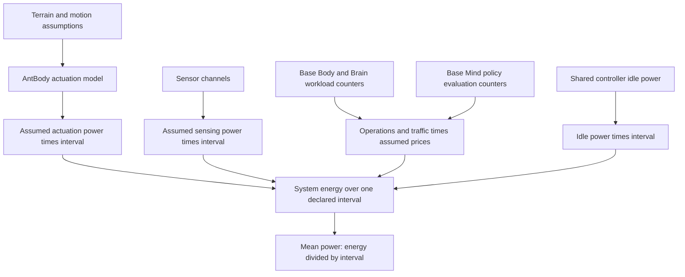

# Analytical Energy Accounting and Assumed Coefficients {#energetics}

## Accounting Boundary and Physical Energy Balance {#energy-analysis-framework}

This section defines analytical accounting, not measured platform performance. Digital prices, sensor power, per-joint actuator power, and idle power are illustrative assumptions in `manifest.example.yaml`; none is calibrated to a named processor, spike circuit, robot, or ant. There is no demonstrated prediction error below 5%, 7 nm attojoule measurement, or species-specific efficiency estimate.

For an identified system boundary, the first-law balance is
\begin{equation}
\frac{dE_{\mathrm{stored}}}{dt}=P_{\mathrm{input}}-P_{\mathrm{dissipated}}-P_{\mathrm{work}}.\label{eq:energy_conservation}
\end{equation}
Here $P_{\mathrm{work}}$ is mechanical work leaving the boundary. Electrical compute consumption and its eventual heat are not separate additive electrical loads. Kinetic energy $mv^2/2+I\omega^2/2$ and potential energy $mgh$ are storage terms; operation-price accounting estimates an electrical input requirement, not a distinct conserved reservoir.

## Compute, Memory, and Idle Energy

Over a window $t$, modeled digital energy is
\begin{equation}
E_{\mathrm{compute}}=N_{\mathrm{FLOP}}e_{\mathrm{FLOP}}+V_{\mathrm{SRAM}}e_{\mathrm{SRAM}}+V_{\mathrm{DRAM}}e_{\mathrm{DRAM}}+N_{\mathrm{spk}}E_{\mathrm{spk}}.\label{eq:brain_energy}
\end{equation}
Coefficients must first be converted to joules per operation, byte, or spike. Window baseline is $E_0=P_0t$. Byte counters denote modeled traffic, not measured rail energy or automatically peak storage. Spike prices omit unspecified host, routing, and I/O costs unless explicitly included in the coefficient boundary.

At the illustrative manifest baseline of 0.50 W, idle energy is 5 mJ per 10 ms, not 0.5 mJ. The 0.5 s workload window contains 50 updates at the assumed 100 Hz and 0.25 J idle energy. These dimensional consequences are not calibration results. Current aggregate numbers are generated in `Generated.md` and not copied into diagrams or prose.

## AntBody: Mechanics and Sensing

For a specified torque/velocity trace, mechanical work is
\begin{equation}
W_{\mathrm{mech}}=\int_{t_0}^{t_1}\tau(t)\omega(t)\,dt.\label{eq:body_work}
\end{equation}
The corresponding electrical requirement depends on drive losses, regeneration, and which positive/negative work convention is used. For nonnegative delivered work and a specified efficiency,
\begin{equation}
E_{\mathrm{elec}}=W_{\mathrm{mech}}/\eta_{\mathrm{drv}}+E_{\mathrm{additional\ losses}}.\label{eq:body_elec}
\end{equation}
Do not add losses already absorbed into $\eta_{\mathrm{drv}}$ a second time. The current example instead uses an assumed per-joint electrical-power coefficient and an assumed sensor-power-per-channel coefficient; it is not a torque-trace measurement. Integrate both over the same interval as compute and idle before forming a complete system budget.

Terrain/friction, duty cycling, and sensor selection can change power. No fixed terrain penalty of 20–40%, duty-cycle saving of 50–80%, universal actuator efficiency, muscle/motor power-density ranking, or battery-to-carbohydrate improvement ratio is established here. Such comparisons require specified devices, operating conditions, and primary measurements. Robot-specific power modeling [@jaramillo2020energy] illustrates why those conditions matter.

## AntBrain: Sparse-Processing Assumptions

The selected base neural workload combines the supported `random` or `structured` population model with channel processing. Enhanced AL–MB–CX counters are a separate model, not the producer of base sweep rows. Activity fraction $\rho$, memory splits, and spike-event counts are modeling conventions. No optimal biological activity fraction, small-world comparison, or measured event-driven energy-saving factor is inferred from them.

Historical processor efficiency trends [@koomey2011energy] motivate attention to energy, but do not set these device prices. Use independently calibrated coefficients before making hardware predictions. Circuit-only spike energy must not be compared with a complete software-system energy without reconciling their boundaries.

## AntMind: Conceptual Layer and Physical Compute

Mind is a conceptual policy/semantic layer, not a proof of zero physical energy. Policy evaluation runs on physical hardware and its base-model FLOP/memory counters contribute to the compute budget. If that work is assigned to a Brain processor, reassign the accounting boundary rather than dropping or double-counting it.

The base Mind model enumerates tree nodes through $H_p$ steps using $B$. The separate enhanced model caps leaf-policy count with `max_policies` (default 1000), or uses exact enumeration for `None`. Neither model establishes a universal horizon of 15 steps or an energy-free symbolic implementation. A time horizon in seconds requires an explicit planning-step duration.

For utilization-based profiling on a particular device, one possible model is
\begin{equation}
E_{\mathrm{mind}}=[uP_{\mathrm{active}}+(1-u)P_{\mathrm{idle}}]\Delta t.\label{eq:mind_energy}
\end{equation}
This is an alternative accounting model requiring measured/utilization inputs, not an extra term to add on top of already priced operations without reconciling overlap. Active inference's variational or expected free energy [@friston2015epistemic] is not automatically thermodynamic energy in joules.

## Integrated Per-Decision Accounting

For a common decision interval, the complete modeled sum is
\begin{equation}
E_{\mathrm{decision}}=E_{\mathrm{actuation}}+E_{\mathrm{sensing}}+E_{\mathrm{body\ compute}}+E_{\mathrm{brain\ compute}}+E_{\mathrm{mind\ compute}}+E_{\mathrm{shared\ idle}}.\label{eq:decision}
\end{equation}
The generated per-decision table uses the selected base compute functions and the configured update rate, with assumed physical terms and one shared idle load. In contrast, raw workload rows are module-isolated compute-plus-idle energies over their individual windows. They are not directly additive system components. Repeats are not additional simultaneous modules or independent measured traversals.

## Figure: Common-Interval Analytical Energy Accounting {#fig:energy_overview}

**Caption:** Analytical accounting boundaries, not measured energy flows. All summed terms share one interval; Mind physical compute and Body compute are retained. Numerical values are generated from the current manifest rather than fixed in this schematic.

## Table: Coefficient Provenance {#tab:coefficients}

| Input | Units | Provenance and interpretation |
|---|---|---|
| FLOP price | pJ/FLOP | Illustrative manifest assumption |
| SRAM/DRAM traffic prices | pJ/byte | Illustrative manifest assumptions; no device fit |
| Spike price | aJ/spike | Illustrative assumption; not whole-system measured energy |
| Idle power | W | Assumed load; once in a shared-controller sum |
| Actuator power | W/joint | Assumed electrical load, not dynamometer output |
| Sensor power | W/channel | Assumed load, not calibrated per-sensor telemetry |

## Transport and Physical References

Dimensionless cost of transport is $\mathrm{CoT}=E/(mgd)$ for energy $E$ and displacement $d$ covering the same traversal. The example's distance does not have a matched modeled locomotion interval, so **CoT is unavailable**, not a measured or inferred locomotion efficiency. At fixed distance, longer duration can add idle energy; equal-speed comparisons must scale distance with time.

Landauer's reference is $k_BT\ln 2$ per erased bit under the stated thermodynamic assumptions [@landauer1961irreversibility], not per FLOP or per decision. A matched erasure count and temperature are needed before comparing totals. Carnot's $1-T_c/T_h$ applies to a heat engine between reservoirs; it is not a generic motor-efficiency ceiling. Shannon capacity requires a channel/noise model [@shannon1948mathematical], not just a sensor-channel count. No optimization gap follows by dividing incomparable quantities.

## Proposed Measurement and Calibration

Device counters and external meters should be time-aligned and accompanied by raw traces, calibration records, measurement boundaries, and held-out workloads. Report genuine independent replicates and parameter uncertainty separately from closed-form repetition and bootstrap Monte Carlo effort. These are proposed protocols, not completed measurements. See Methods and the external-data integration guide.

## Units and Conversions

$1\,\mathrm{W}=1\,\mathrm{J/s}$; $1\,\mathrm{mJ}=10^{-3}\,\mathrm{J}$; $1\,\mathrm{pJ}=10^{-12}\,\mathrm{J}$; $1\,\mathrm{aJ}=10^{-18}\,\mathrm{J}$. A platform mass of $0.001\,\mathrm{kg}$ is $1\,\mathrm{g}$, whereas $1\,\mathrm{mg}=10^{-6}\,\mathrm{kg}$.
