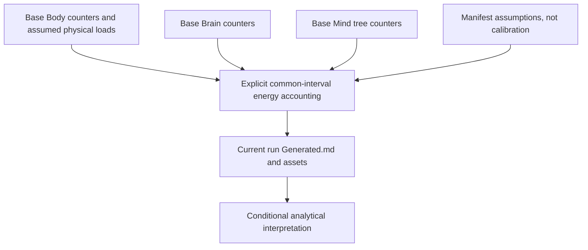

# Computational Complexity and Energetics of the Ant Stack

## Analytical Scope and Evidence Boundary {#scope-and-research-philosophy}

This companion manuscript studies **analytical workload and energy models**, not measured validation of an ant, robot, or processor. Body, Brain, and Mind are conceptual accounting boundaries. Input coefficients and dimensions are illustrative assumptions; current numeric results belong only in `Generated.md` from the corresponding completed governed run.

Compute-aware planning research [@sudhakar2020balancing] motivates comparing computation and actuation costs. Historical computing-efficiency trends [@koomey2011energy] do not calibrate this example's coefficients. No independent raw calibration, species-validation dataset, or demonstrated publication-readiness result is identified here.

## Reproducible Inputs and Products

`manifest.example.yaml` selects base closed-form workloads, supported `pgs`/`si`/`ldlt` contact models and `random`/`structured` neural patterns, canonical Mind $B,H_p$, and a null meter. Workload rows are isolated compute-plus-idle estimates over their windows. The separate system per-decision table uses the same base compute models, assumed physical actuation/sensing, and one shared idle baseline. Mind physical compute is not zero. CoT is unavailable without a matched modeled locomotion interval for the distance.

The package CLI writes every CE product beneath the fresh normalized `--out` destination: tabular/provenance outputs, `assets/`, and `Generated.md`. Governed `run-all-antstack` publishes canonical results beneath `outputs/<run_id>/` and projects explicitly completed products to paper-local compatibility `out/`, `assets/`, and `Generated.md`, preserving source-owned guides. Do not hand-copy arbitrary output-tree contents or treat a historical compatibility artifact as a completed fresh run.

From the repository root, the release owner can generate a fresh CE result tree (destination must not already contain a prior run):

```bash
uv run antstack-ce papers/complexity_energetics/manifest.example.yaml --out outputs/ce-manuscript-fresh
```

For governed canonical orchestration and compatibility projection, use the root guide's `run-all-antstack` configuration and command. Publication configuration marks CE analysis as required and uses the package module, not the removed paper-local runner. Rendering is a separate governed acceptance step. No generation or render is claimed by these source edits.

## Figure: Ant Stack Overview and Flow {#fig:stack_overview}



**Caption:** Source-owned conceptual schematic. Numeric outputs are generated, while coefficients remain assumptions until independently calibrated. Separate enhanced models are not implicitly substituted for selected base workloads.
