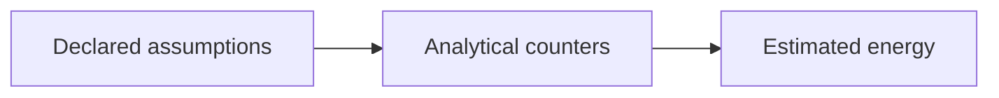

# Configured Scientific Publishing: Sources, Counters, and Proof

## One installed renderer, explicit caller-owned inputs

`antstack_core.publishing.paper_builder.ModularPaperBuilder` discovers `papers/<name>/paper_config.yaml`. The `antstack-build` console command works from an installed wheel; it reads caller-owned manuscript/configuration files and does not import this repository's `scripts/` directory or require pytest at runtime. `tools/render_pdf.sh` only launches the same implementation.

The builder uses `content.files` in its listed order, not alphabetical order. Names must stay inside the paper directory. The output is one PDF basename in the project root. Analysis, when enabled, uses the explicitly supported installed CE runner and a fresh artifact root before projecting current generated content.

```yaml
paper:
  title: "Analytical Model and Explicit Assumptions"
  author: "Author"
  output_filename: "analysis.pdf"
content:
  files: ["Abstract.md", "Methods.md", "Results.md"]
build:
  has_computational_analysis: false
  mermaid_preprocessing: true
  cross_reference_validation: true
latex:
  document_class: "article"
  geometry: "margin=2.5cm"
  mainfont: "Latin Modern Roman"
  mathfont: "Latin Modern Math"
  bibliography: "references.bib"
```

Directory signposts and metadata are not executable scientific guarantees. Validate the real configuration and inputs; then run the actual build.

## Readiness is not a render

```bash
uv run antstack-build --validate-only
uv run antstack-build --paper complexity_energetics
uv run antstack-build --project-root cache/paper-proof
```

Validation checks configured Markdown sources, explicit reference declarations and citation-key coverage where a bibliography is configured. It writes `build_report.md` but no PDF. It cannot establish actual image decoding, counter placement, fonts, browser compatibility, citation identity, page layout or scientific validity.

A staging project has its own copied `papers/` inputs and output root. It avoids replacing source projections/PDFs during proof. Failed attempts retain diagnostics; a previous PDF is preserved, never treated as a fresh result.

## Put labels and detailed captions on the actual counter

An image caption belongs to the figure, not an unrelated paragraph that can float onto another page. Include the relevant units, interval, assumptions and evidence class in the caption. One identifier is enough:

```markdown
{#fig:energy_budget}

See Figure @fig:energy_budget.
```

Existing explicitly labeled figure/table counter headings are bound to their following actual counter. Do not attach a figure/table ID to an ordinary section and assume it creates that counter. Missing, duplicate or conflicting definitions are errors; they are not automatically retargeted to similar names.

For sections, identify the actual heading:

```markdown
## Accounting assumptions {#sec:accounting_assumptions}

See Section @sec:accounting_assumptions.
```

Keep table captions descriptive and column units explicit. A sample count of deterministic recalculations is not an empirical sample size. Distinguish mean, total, workload window, decision interval, power and energy.

## Number equations deliberately; preserve literal code

Inline math can use `$...$` or `\(...\)`; display math can use `$$...$$` or `\[...\]`. An unnumbered display does not supply an equation counter. Use a numbered environment before referring to its label:

```markdown
\begin{equation}
E_{\mathrm{idle}} = P_{\mathrm{idle}} t
\label{eq:idle_energy}
\end{equation}

See Equation @eq:idle_energy.
```

LaTeX macros are the clearest portable mathematical spelling: `$\alpha + \beta \ge 0$`. Supported Unicode math in prose/math is normalized on parsed nodes. URLs, code, resource paths and identifiers must remain unchanged. Literal code may itself contain Unicode:

```python
label = 'α ≤ β'
```

That code needs a font containing those glyphs; mathematical normalization must not rewrite it into different program text. Missing glyphs are render failures, not warnings to suppress. The selected font/toolchain and final rasterized page determine readability.

The renderer requires [fvextra](https://ctan.org/pkg/fvextra) 1.7 or newer (2024-05-16 feature set) to wrap long fenced-code lines, including highlighted unbroken tokens, without changing the source or adding characters to copied code. TeX Live 2022's bundled package is too old. Repository CI installs checksum-pinned fvextra 1.14.0 under its private `TEXMFHOME`; use a current TeX distribution or an explicit project-private TeX package tree, not a global configuration edit or disabled check. Inspect the final page; a successful build does not excuse clipped examples.

## Source-relative assets must remain unambiguous

An image path is resolved relative to its own Markdown file. Two source directories can both contain `figure.png`; do not flatten them by basename or search the process working directory as an undocumented fallback. Images must be explicit local resources. SVG conversion requires `rsvg-convert`; conversion/producer failure must not reuse a stale PNG.

Document-wide references and ordered source assembly matter across module boundaries. Repeated generic headings must not make separate valid modules unrenderable, while duplicate **explicit** IDs remain errors. Give important sections stable explicit IDs and retain them when improving titles.

## Mermaid needs a real, qualified local browser

Active Mermaid fences are rendered locally with the pinned CLI. Code examples nested inside longer Markdown fences are examples, not diagrams to execute. Preserve graph labels and topology; deleting syntax or semantic edges is not a valid repair.

Give each real diagram a native Mermaid `accTitle: ...` declaration after its diagram type. The renderer uses that accessibility title as its descriptive figure caption, escaping Markdown syntax rather than exposing a cache hash as the only explanation.

````markdown
## Figure: Assumptions-to-output workflow {#fig:analytical_workflow}


````

`ANTSTACK_MMDC` can select an explicit local CLI and `PUPPETEER_EXECUTABLE_PATH` an existing compatible browser. Keep caches/profiles local to the project. Chromium's sandbox stays enabled. There is no automatic public-service upload or Docker fallback; an explicitly supplied Kroki endpoint is a separate caller trust decision.

On macOS, an outer qualified runner can prevent Chromium from initializing its nested sandbox. Record the failure and use a separately permitted project execution environment; do not mark it green by disabling sandboxing or reusing old diagrams. Repository CI must execute the real render and retain its source/runtime-bound output for inspection.

## Citations need both syntax checks and primary-source verification

Use keys that exist in the configured bibliography, for example `[@key]`. Undefined keys and duplicate bibliography entries are errors. Coverage does not establish that a DOI, author, year or claimed finding is correct. Verify those against primary records; never manufacture a reference from a familiar-looking name or “repair” an unresolved key by guesswork.

Raw TeX, Jinja templates, bibliography/resources and local endpoints are trusted author input, not a security sandbox. Do not put credentials in inputs or expect source/config snapshots to redact them.

## Distinguish analytical reports, full manuscripts, and historical copies

The example CE manifest uses assumed prices and a null meter. Its deterministic counts, fitted curves and bootstrap summaries are model-conditional outputs, not independent observations, calibrated uncertainty, or demonstrated real-time/biological performance. Base and enhanced models must remain separately labeled.

Run-all `build_pdf: true` renders a generated analytical-results report. The default `build_pdf: false` copies an explicitly historical PDF. Neither operation is a fresh build of the complete configured manuscript. Use `antstack-build` for that manuscript and verify its ordered sources, current generated projection and actual bibliography.

## Accept only an inspected, source-bound result

1. Record exact source/package, input snapshots, dependency/runtime/tool versions and invocation.
2. Run native tests/lint/folder checks and entrypoint validation without skipping failures.
3. Execute actual installed CLI paths, the configured workflow and requested paper builds.
4. Recompute artifact hashes and verify current projection agreement.
5. Inspect PDF pages at final scale: math, glyphs, counters, captions, tables, citations, links and figures.
6. Trace numerical graphics/tables to the same completed run; disclose synthetic data, assumptions and missing empirical validation.
7. Record failures, unavailable tools and non-runs explicitly. Compilation is not visual acceptance or scientific certification.

Version metadata, a tag, a pushed main commit and a hosted repository release are distinct states. A private Node tool package is not authorization to publish to a registry. Follow the repository's actual release/write admission; never bypass a disabled class, branch protection, required checks or an exact confirmation requirement.
